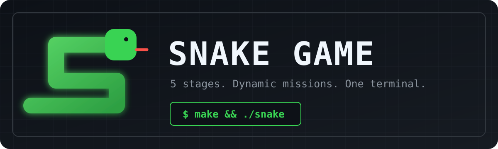

<p align="center">
  
</p>

<p align="center">
  <a href="https://github.com/seopseopi/C-_2026_teamProject/actions/workflows/build.yml"></a>
  
  
  
</p>

<p align="center">
  C++17과 ncurses로 구현한 5단계 터미널 스네이크 게임입니다.<br>
  성장만 하는 고전 규칙에 게이트, 아이템, 속도 존, 발사체, 미션과 랭킹을 더했습니다.
</p>

## 주요 기능

- 서로 다른 구조의 맵 5개와 단계별 미션
- 20초마다 위치가 바뀌는 한 쌍의 게이트와 진출 방향 판정
- Growth, Poison, Invincible, Mystery 아이템
- 뱀의 이동 속도를 바꾸는 2x2 Slow/Fast Zone
- 경고 후 맵 안쪽으로 발사되는 Red Wall Projectile
- 실시간 Score Board, 스테이지 타이머, A+~F 등급과 Overall 랭킹
- 플레이 시간과 아이템 획득에 따른 동적 속도 변화

## 아이템과 기믹

| 요소 | 효과 |
| --- | --- |
| Growth | 몸길이 +1, 4개 획득할 때마다 속도 증가 |
| Poison | 몸길이 -1, 3개 획득할 때마다 속도 감소 |
| Invincible | 약 5초 동안 벽과 Poison/Red Wall 피해 방어 |
| Mystery | Growth, Poison, Invincible 중 하나를 무작위 적용 |
| Gate | 반대편 Gate로 이동하며 벽 위치에 따라 진출 방향 결정 |
| Red Wall | 5초간 경고한 뒤 발사되며 피격 시 몸길이 3 감소 |

## 실행 방법

권장 터미널 크기는 `100 x 30` 이상입니다. 게임 데이터의 상대 경로를 사용하므로 프로젝트 루트에서 실행해 주세요.

### macOS

Command Line Tools가 없다면 먼저 `xcode-select --install`로 설치합니다.

```bash
git clone https://github.com/seopseopi/C-_2026_teamProject.git
cd C-_2026_teamProject
make
./snake
```

### Ubuntu / Debian

```bash
sudo apt update
sudo apt install -y build-essential libncurses-dev

git clone https://github.com/seopseopi/C-_2026_teamProject.git
cd C-_2026_teamProject
make
./snake
```

### Windows

[MSYS2](https://www.msys2.org/)를 설치한 뒤 UCRT64 환경에서 다음 중 하나를 실행합니다. 스크립트가 ncurses 설치, 빌드, 실행을 순서대로 처리합니다.

```bat
build-snake.cmd
```

또는 MSYS2 UCRT64 터미널에서:

```bash
./build-snake.sh
```

## 조작법

| 키 | 동작 |
| --- | --- |
| `↑` `↓` `←` `→` | 이동 방향 변경 |
| `Q` | 게임 종료 |
| `Enter` | 클리어/게임 오버 화면 확인 |

현재 이동 방향의 반대 키를 누르거나 벽·몸통과 충돌하면 게임 오버입니다.

## 개발 명령어

```bash
make             # 빌드
make run         # 빌드 후 Stage 1 실행
./snake 3        # 디버깅용 Stage 3 시작 (1~5)
make validate    # 맵 파일 구조 검사
make check       # 빌드 + 맵 검사
make clean       # 생성 파일 제거
```

## 스테이지 미션

모든 조건을 동시에 달성하면 다음 스테이지로 이동합니다. Body는 현재 길이가 아니라 해당 스테이지에서 달성한 최대 길이를 기준으로 합니다.

| Stage | Body | Growth | Poison | Gate |
| :---: | :---: | :---: | :---: | :---: |
| 1 | 10 | 3 | 1 | 1 |
| 2 | 12 | 4 | 1 | 1 |
| 3 | 14 | 5 | 2 | 2 |
| 4 | 16 | 6 | 2 | 2 |
| 5 | 18 | 7 | 3 | 3 |

## 프로젝트 구조

```text
.
├── data/                  # Stage 1~5 맵 데이터
├── include/               # 클래스 인터페이스
├── src/
│   ├── main.cpp           # 게임 루프와 스테이지 전환
│   ├── Map.cpp            # 맵 로드와 렌더링
│   ├── Snake.cpp          # 기본 이동·충돌
│   ├── ItemSnake.cpp      # 아이템 효과가 있는 뱀
│   ├── Item.cpp           # 아이템 생성·수명 관리
│   ├── Gate.cpp           # Gate 생성·이동 규칙
│   ├── Zone.cpp           # Slow/Fast Zone
│   ├── RedWallProjectile.cpp
│   └── ScoreBoard.cpp      # 미션, 시간, 등급 UI
├── scripts/               # 맵 검증 도구
└── Makefile
```

## Team 7

- [이민섭](https://github.com/seopseopi) — Team Lead
- [강혁주](https://github.com/dotori2744)
- [권우석](https://github.com/a1paka12)
- [이지훈](https://github.com/hoon1002)

---

Kookmin University, C++ Programming Final Project, 2026.
